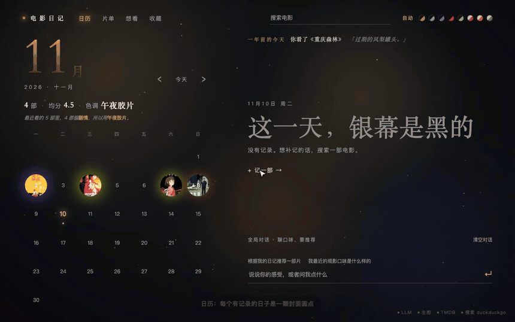
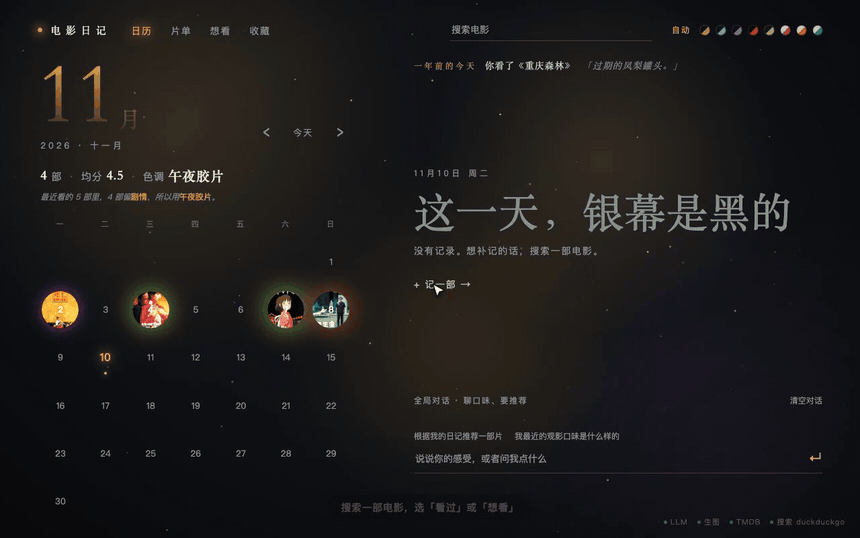
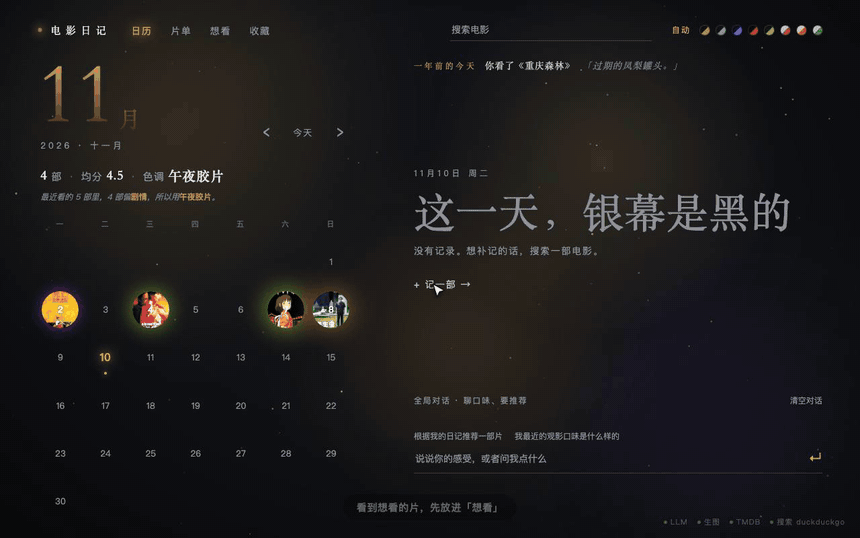
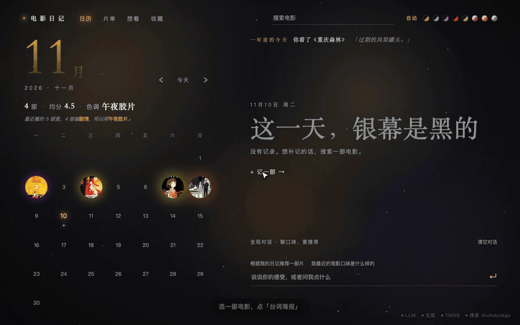
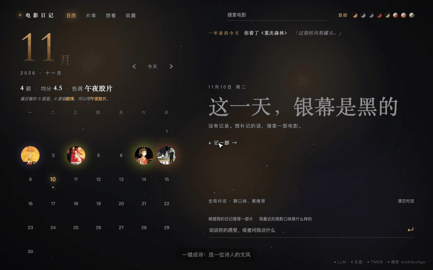

# 电影日记

一本按日历翻阅的观影日记，带一个能联网、能写日记、能做海报和写诗的 Agent。

在日历上记下每天看了什么、打几星、有什么感受。也可以直接对 Agent 说一句话，它会去查片、替你写进日记。看完之后，把喜欢的台词做成海报，或者让某位诗人替你写一首诗。

> 动画录自真实界面，封面和剧照是 TMDB 的真实图片。对话内容是事先写好的演示脚本。

想自己跑起来，或者了解配置和实现，看 **[技术说明](docs/technical.md)**。

## 日历：每一天看了什么，一眼就知道

有记录的日子是一颗封面圆点，一天看了两部就并排两颗。点某一天，右侧展开当天的电影。左侧显示本月看了几部、平均几星。

**配色跟着你看的片走。** 最近看了悬疑片，页面就变成冷雾色，下着细雨；看了科幻，换成霓虹紫。一共 8 套，也可以在右上角手动切换。

| 名称 | 适合的类型 |
|---|---|
| 午夜胶片 | 剧情 |
| 冷雾 | 悬疑、犯罪、惊悚 |
| 霓虹 | 科幻、奇幻 |
| 暗红 | 恐怖 |
| 军绿 | 战争、历史、西部、冒险 |
| 蔷薇 | 爱情、音乐 |
| 奶油 | 喜剧、动画 |
| 鼠尾草 | 家庭、纪录 |

页面顶部还有一行“去年今天”：往年的这一天，你看过什么、写过什么。

## 记一部电影：搜索、打分、写一句感受

搜索片名，点「看过」，点星星打分，再写一句感受、加几个标签。日期默认是你在日历上选中的那天，也可以改。

## 直接和 Agent 说话

不想点按钮，就直接说：“昨天看了盗梦空间，4 星，梦境一层套一层。” Agent 会去查片、写进日记，再顺着你的感受追问一句。

- **聊整本日记**：问它“根据我的日记推荐一部片”，它会读你的评分和感受，并说明为什么适合你。
- **聊某一部电影**：点「聊聊这部」，对话只围绕这一部，并且单独保存。
- **查幕后和解读**：直接问，它会联网搜索，回答末尾附上来源链接。搜不到就直说，不编造。

## 想看清单

看到想看的片，先放进「想看」。它不占日历，也不影响配色。看完之后点「看完了」，一键转成已看，并直接展开评分和感受。

## 台词海报

把喜欢的台词做成一张竖版海报，有两种做法。

### 剧照拼贴：几秒出图

从 Wikiquote 查这部片的台词，勾选最多 4 句，用这部电影的剧照拼成海报。不需要生图模型，几秒就好。

下面是日记里实际生成的一张，《给阿嬷的情书》：

### AI 生图：给一句台词配一个氛围

选一句台词，模型先读这部电影和你的记录，写出画面的意境，再交给生图模型画背景。台词文字由程序排上去，所以不会出现错字。生图失败时会自动换成渐变背景，海报照样做出来。

## 一键成诗

选一位诗人，模型按那位诗人的文风，结合这部电影和你的感受写一首短诗。不满意可以再写一首，或者换一位。

共 22 位，中国 10 位，外国 12 位：

- **中国**：徐志摩、戴望舒、林徽因、穆旦、艾青、北岛、舒婷、顾城、海子、余光中
- **外国**：泰戈尔、狄金森、里尔克、聂鲁达、波德莱尔、惠特曼、叶芝、普希金、博尔赫斯、辛波斯卡、茨维塔耶娃、谷川俊太郎

## 收藏

台词、截图和诗放在同一页。每张卡片都能跳回对应的电影。

- **台词**：在电影详情里收藏，或者让 Agent 替你收藏。
- **截图**：上传你自己截的画面。
- **诗**：从「一键成诗」保存。

## 开始使用

需要 Python 3.10 以上，以及一个支持工具调用的大模型接口和 TMDB 的 key。安装、配置和启动步骤见 **[技术说明](docs/technical.md#快速开始)**。

更多内容：

- [配置项](docs/technical.md#配置)
- [数据存在哪里](docs/technical.md#数据存在哪里)
- [HTTP 接口](docs/technical.md#http-接口)
- [Agent 能用的工具](docs/technical.md#agent-能用的工具)
- [各功能的规则与限制](docs/technical.md#功能实现细节)
- [已知限制](docs/technical.md#已知限制)

---

动画和示例海报里出现的电影海报和剧照，版权属于各自的片方，仅用于演示本工具的界面。
